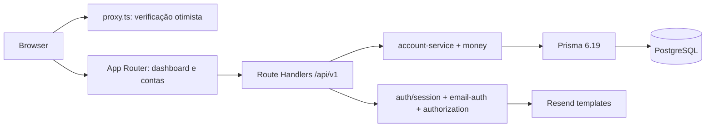

# Arquitetura

## Topologia

Não existe NestJS, Express ou uma API independente. Controllers são Route Handlers finos; regras ficam em `web/lib`.

## Camadas

- `lib/auth`: token, sessão e autorização server-side;
- `lib/money`: decimal, escala, validação e serialização;
- `lib/account-service`: criação atômica, saldo inicial e exclusão segura;
- `lib/validation`: DTOs manuais, enums, datas e campos permitidos;
- `app/api/v1`: HTTP e status codes;
- `app/(app)`: UI autenticada.
- `lib/email`: cliente Resend e catálogo de templates publicados;
- `lib/auth/email-auth`: confirmação, OTP e URLs de autenticação.

## Fluxo de escrita

Criação de conta, membro, saldos e lançamentos iniciais ocorre em uma única `prisma.$transaction`. O saldo atual é projeção; o ledger permanece fonte auditável. O protótipo ainda não usa lock explícito por saldo. Evolução: serialização por conta/ativo, advisory lock PostgreSQL ou fila de escrita.

## Segurança

O proxy apenas verifica presença do cookie. Cada handler privado consulta e valida `AuthSession` no banco e depois verifica owner/member/role. Relações financeiras usam `Restrict`; somente sessões usam cascade.
