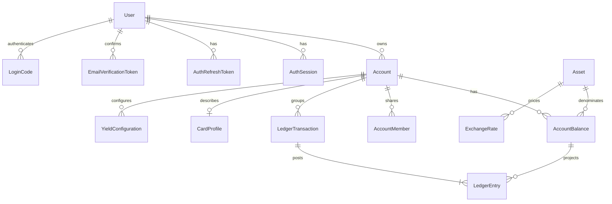

# Modelo de dados

`Account` é o agregado exibido como conta, carteira ou cartão. Uma conta pode possuir muitos `AccountBalance`, permitindo Prex com USD e UYU simultaneamente.

Models: `User`, `AuthSession`, `AuthRefreshToken`, `EmailVerificationToken`, `LoginCode`, `Asset`, `Account`, `AccountBalance`, `AccountMember`, `AccountShareInvitation`, `CardProfile`, `YieldConfiguration`, `LedgerTransaction`, `LedgerEntry`, `FxConversion`, `BalanceSnapshot`, `ExchangeRate`, `WaitlistEntry`.

Tokens e códigos são armazenados somente como SHA-256, com expiração e uso único quando aplicável.

Dinheiro, cripto, saldo, cotação, taxa e conversão usam `Decimal(38,18)`. Percentuais/rendimento usam `Decimal(24,12)`. `Asset.decimals` define escala operacional: BRL/USD/EUR/UYU 2, CLP conforme catálogo, BTC 8. O banco suporta até 18.

`LedgerEntry.amount` é positivo; direção define sinal. `balanceAfter` permite auditoria. Não apagar histórico financeiro: arquivar ou reverter.

Cartão guarda tipo, bandeira, últimos quatro e limites. Nunca PAN, CVV ou número completo. `creditLimit` usa decimal e `limitAssetId` referencia catálogo.

Sem seed, `Asset` começa vazio. Provisionamento administrativo futuro deve criar BRL, USD, EUR, UYU, CLP e BTC com escalas corretas.
